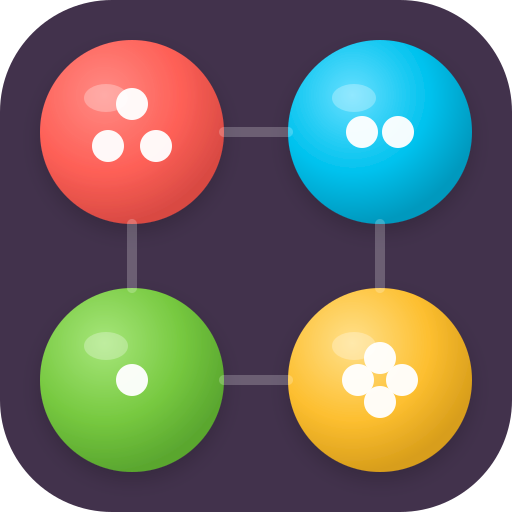

<p align="center">
  
</p>

# Color Wars

**Color Wars** is a real-time multiplayer chain-reaction strategy game for **2–8 players**. Claim your starting cell, charge it with dots, trigger explosive chain reactions, capture territory, and outlast everyone on the board.

- **Live multiplayer:** WebSocket rooms with reconnect/rejoin support
- **Tactical gameplay:** timing, positioning, and chain reactions decide the match
- **Responsive UI:** built for desktop and mobile browsers
- **Stack:** React + Vite + Tailwind CSS (client), Hono + WebSockets (server), Cloudflare Workers/Durable Objects support, shared TypeScript game logic

## Gameplay rules

- **Players:** 2–8 players on a grid (board size scales with player count).
- **First move:** your first turn must be on an **empty cell**. That creates your starting cell with **3 dots**.
- **Later turns:** you can only **increment (add a dot to) a cell you already own**. You cannot place a new cell elsewhere.
- **Critical mass:** a cell explodes when it reaches the number of orthogonal neighbors  
  - **2** in corners  
  - **3** on edges  
  - **4** in the middle
- **Explosions:** at critical mass, the cell loses that many dots and sends **1 dot to each orthogonal neighbor**, capturing those neighbors. Explosions can **chain** until the board stabilizes.
- **Elimination:** players are eliminated when they control no cells (after everyone has taken a first turn).
- **Win condition:** last player standing wins.

## Project structure

```text
.
├─ client/   # React + Vite frontend (UI, animations, SEO assets)
├─ server/   # Hono WebSocket server + Cloudflare Worker/Durable Object room backend
├─ shared/   # Shared TypeScript game rules/types
└─ README.md
```

## Prerequisites

- [Bun](https://bun.sh/) (used for install/build/dev scripts in this repo)
- Node.js available in environment is fine, but commands below use Bun

## Local development

```bash
# install dependencies
bun install

# build shared package (recommended before first run)
bun run --filter @game/shared build

# terminal 1: start websocket/http server (default :3001)
bun run dev:server

# terminal 2: start vite client (default :5173)
bun run dev:client
```

Open `http://localhost:5173`, create a room, and share the room code/join flow with other players.

### Client environment variables

| Variable | Required | Description |
|---|---:|---|
| `VITE_WS_URL` | for non-local/prod | WebSocket server base URL used by the client. Example local: `ws://localhost:3001`. Example production: `wss://your-server-domain`. |

> `VITE_*` variables are **build-time** values. Changing `VITE_WS_URL` requires rebuilding/redeploying the client.

## Build

```bash
bun run build
```

This runs shared, client, and server builds.

## Deployment

### Backend (Cloudflare Workers + Durable Objects)

The repo includes Cloudflare Worker/DO configuration in `server/` (`wrangler.toml`, `server/src/cf.ts`, `server/src/RoomDO.ts`).

Example:
```bash
cd server
bunx wrangler deploy
```

After deploy, note your Worker URL, e.g.  
`https://multiplayer-color-wars-server.<subdomain>.workers.dev`

The client connects to the WebSocket endpoint at `/ws`, so your production client should use:  
`VITE_WS_URL=wss://multiplayer-color-wars-server.<subdomain>.workers.dev`

### Frontend (Cloudflare Pages recommended)

**Option A: Cloudflare Pages (Git-connected)**
- **Root directory:** `/` (repo root)
- **Build command:** `bun install && bun run --filter @game/shared build && bun run --filter @game/client build`
- **Build output directory:** `client/dist`
- **Environment variable:** `VITE_WS_URL=wss://<your-backend-domain>`
- **Deploy command:** not needed for Pages (if a field is required in your UI, use a no-op like `echo "Deploy handled by Cloudflare Pages"`)

**Option B: Direct Pages deploy with Wrangler**
```bash
# from repo root (with VITE_WS_URL available at build time if needed)
bun install
bun run --filter @game/shared build
VITE_WS_URL=wss://<your-backend-domain> bun run --filter @game/client build
bunx wrangler pages deploy client/dist --project-name <your-pages-project>
```

### Frontend (Vercel)

Vercel is fine for the static/client frontend (backend WebSockets run separately on your server/Worker).
- Set `VITE_WS_URL` in Vercel project environment variables
- Build `@game/shared` before `@game/client`
- Output `client/dist` (configure root/build/output according to your Vercel project settings)
- Redeploy after changing `VITE_WS_URL`

## Live deployments

- **Primary (canonical):** https://color-wars.nextpointer.dev/
- **Vercel:** https://multiplayer-color-wars.vercel.app/

Use the primary domain as the canonical URL for SEO/indexing. Keep alternate deployments accessible, but avoid making them compete as separate canonical pages.

## SEO, branding, and social assets

This repo includes on-site SEO and branding foundations:

- `client/index.html`: title/description/keywords, canonical, robots directives, Open Graph/Twitter meta, JSON-LD structured data, PWA/icon links, noscript content
- `client/public/favicon.svg`: 4-color Color Wars SVG icon/logo
- `client/public/icons/`: raster logo/app icons (PNG)
- `client/public/icons/apple-touch-icon.png`: Apple touch icon
- `client/public/social/og-image.png`: Open Graph/Twitter share image (1200×630)
- `client/public/site.webmanifest`: web app manifest
- `client/public/robots.txt`: crawl rules + sitemap location
- `client/public/sitemap.xml`: sitemap
- `client/public/llms.txt` and `client/public/llm.txt`: LLM-friendly site/game info, canonical/alternate URLs, and similar game suggestions

### Canonical domain configuration

Canonical/OG/sitemap/robots URLs are currently configured for **`https://color-wars.nextpointer.dev/`**. If you change the primary domain, update absolute URLs in:
- `client/index.html` (`canonical`, `hreflang`, `og:url`, `og:image`, `twitter:image`, JSON-LD `url`/`image`, noscript links if desired)
- `client/public/robots.txt` (`Sitemap`)
- `client/public/sitemap.xml` (`<loc>`)
- `client/public/llms.txt` and `client/public/llm.txt` (URLs)

Then rebuild and redeploy the client.

### Similar color / chain-reaction games (suggestions)

If players want games like Color Wars, good suggestions are:
- **Chain-reaction / critical-mass:** Chain Reaction (classic), Chain Reaction by Buddy Matt Entertainment, Atoms, Exploding Dots-style critical-mass games
- **Color territory capture (different mechanics, similar feel):** Paper.io 2, Splix.io, Hexar.io / Superhex.io

These suggestions are also included in `client/public/llms.txt` (and `llm.txt`) for LLM/discovery use.

### GitHub repository SEO / sharing

- **About section:** add a clear description and website URL in your GitHub repo settings.
- **Topics:** add relevant topics (e.g. `multiplayer-game`, `websocket`, `react`, `typescript`, `hono`, `cloudflare-workers`, `strategy-game`, `chain-reaction`).
- **Social preview image:** in GitHub **Settings → Social preview**, upload `client/public/social/og-image.png` (or a repo-specific 1280×640/1200×630 image) so shared repo links look branded.
- **README logo/preview:** this README includes the 4-color logo from `client/public/icons/color-wars-logo-512.png`.
- **Releases/tags:** publish releases for notable milestones to improve project credibility/discoverability.

### Search ranking reality check (Google & DuckDuckGo)

There is **no guaranteed way** to rank #1 on Google or DuckDuckGo. Rankings depend on crawl/indexing, content quality, competition, backlinks, domain authority, user engagement, and time. This project now includes strong technical/on-page foundations; to improve your chances:
- deploy on a stable canonical domain and submit `sitemap.xml` in Google Search Console / Bing Webmaster Tools
- ensure pages are publicly accessible, fast, and mobile-friendly
- get relevant backlinks/mentions (GitHub, communities, directories, game portals)
- keep content accurate and update it over time
- avoid duplicate URLs/content across deployments

## Scripts

From repo root:
- `bun run dev:server` — run server in watch/dev mode
- `bun run dev:client` — run Vite client dev server
- `bun run build` — build shared, client, and server

## Notes

- Real-time gameplay requires a reachable WebSocket backend (`VITE_WS_URL`) and browser WebSocket support.
- For secure production sites (`https://`), use `wss://` for the game server.
